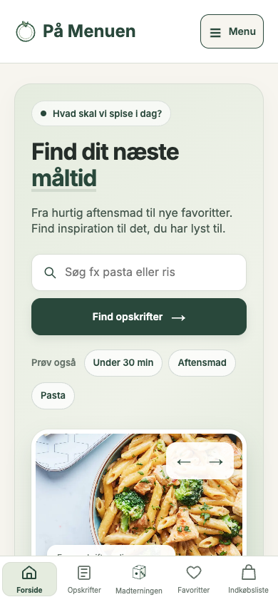
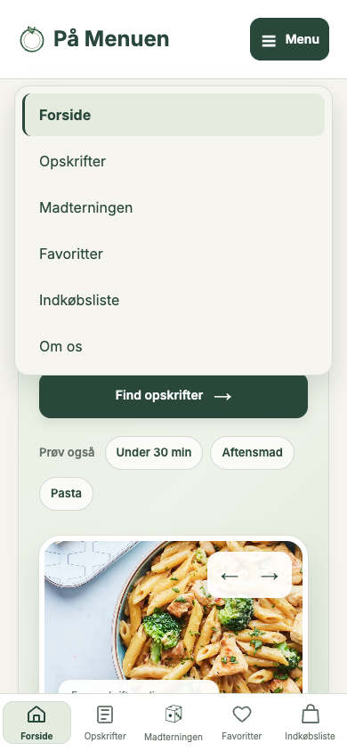

# Mobilmenu efter Sabrinas brugertest

18. oktober 2026 · Branch `forbedret-mobilmenu` · Udgangspunkt: main `abea05e`.

## Hvorfor ændrede vi navigationen?

Martin viderebragte en observation fra Sabrinas brugertest om behovet for en mere synlig mobilnavigation. Vi tilføjede derfor en ekstra indgang øverst i headeren. Bundnavigationen er stadig tilgængelig, så den kendte vej rundt på siden bevares.

Vi har ikke indsamlet nye deltagerresultater i denne iteration. Vi forventer, at knappen gør navigationen lettere at opdage, men den effekt skal kontrolleres med brugere.

## Hvad ændrede vi?

På alle syv sider står logo og “På Menuen” til venstre. En knap med ☰ og “Menu” står til højre. Den åbner Forside, Opskrifter, Madterningen, Favoritter, Indkøbsliste og Om os. Den aktuelle side er fremhævet; på en opskriftsdetalje markeres sektionen Opskrifter.

Burgermenuen vises **kun under 700 CSS-px**, som er projektets eksisterende grænse til tablet-layout. Ved 700–1099 px bevares den tidligere header med Om os samt bundnavigationen. Fra 1100 px bevares den eksisterende desktopnavigation og søgning. Afgrænsningen følger viewportens layout, ikke en bestemt telefonmodel.

Menuen genbruger mørkegrøn, creme, sage, Inter og de eksisterende fokusmarkeringer. Knap og links har mindst 48 px høje trykflader. Der er ingen ny animation eller nye runtimeafhængigheder.

## Hvordan virker koden?

Headeren bruger en almindelig HTML-knap og et `nav` med en liste af links. `aria-controls` forbinder knappen med navigationen. JavaScript ændrer `hidden`, `aria-expanded` og knappens tilgængelige navn. Det er en almindelig dropdown-navigation, ikke en ARIA-applikationsmenu.

Click-listeners åbner og lukker. Escape lukker og giver fokus tilbage til knappen. Tab og Shift+Tab følger de almindelige links; når fokus forlader headeren, lukkes menuen. Klik udenfor og aktivering af et link lukker også. Ved skift til tablet/desktop lukkes menuen, og eventuelt fokus i den skjulte menu flyttes til logoet.

CSS placerer menuen under headeren og begrænser dens højde, så den ikke dækker bundnavigationen. På korte skærme kan listen rulles. `env(safe-area-inset-*)` giver plads til skærmens sikre områder. Uden JavaScript skjules den inaktive knap, mens det gamle Om os-link og bundnavigationen bevares.

## Hvordan testede vi?

Chrome 155.0.8059.80 og Playwright 1.62.1 mod en lokal server. Alle syv sider er besøgt.

| Kontrol | Resultat |
| --- | --- |
| Mobilmenu: 13 størrelser × syv sider samt seks ekstra forløb | 97/97 |
| Eksisterende funktionelle browserchecks | 57/57 |
| JavaScript-logik | 14/14 |
| Eksisterende navigationschecks | 70/70 |
| Eksisterende responsive layoutchecks | 77/77 |
| Sammenligning med main | Bundnavigation uændret i 49 tilfælde; header uændret i 35 tablet-/desktoptilfælde |

Menutesten bruger 320×740, 390×844, 667×375, 699×800, 700×800, 768×1024, 1024×768, 1099×800, 1100×800, 1440×900, 1920×1080, 844×390 og 390×320. Den kontrollerer åbning/lukning, alle seks links, touch, Enter, Space, Tab, Shift+Tab, Escape, klik udenfor, aktuel side og vandret overflow.

Ekstra forløb omfatter resize, API-netværksfejl, JavaScript slået fra og Chromes safe-area-emulering i portræt og landskab. [Den officielle Chrome-protokol](https://chromedevtools.github.io/devtools-protocol/tot/Emulation/#method-setSafeAreaInsetsOverride) bruges kun i testværktøjet. Dette er ikke en fysisk iPhone-test, en manuel screenreader-test eller en ny brugertest.

### Hvad fandt vi under testen?

Ved 320 px rykkede knappen først ned på en ny linje. Logoet kan nu tilpasse sin plads, og knappens vandrette padding er lidt mindre. Den nye header har plads til begge dele.

Den første outside-click-test forventede altid fokus på menuknappen. Et almindeligt klik udenfor kan naturligt flytte fokus til det klikkede område. Testen kontrollerer derfor, at et skjult menulink ikke beholder fokus; Escape skal stadig give fokus tilbage til knappen.

To ældre browserassertions var allerede uforenelige med den nye footer på main. Der findes nu to “Prøv Madterningen”-links, og footeren gør en tom favoritside længere end én skærm. Det er reproduceret på main. Testen afgrænser nu forsidens CTA til Madterningen-banneret og kontrollerer naturlig indholdshøjde frem for at forbyde den eksisterende footers scrolling. Footeren er ikke ændret.

En tidlig menukørsel ramte en load-timeout på Om os. Testen venter nu på dokument, initialiseret menu og fonts frem for at lade alle ressource-load-events styre navigationskontrollen. Serverloggen blev flyttet fra terminalen til en fil. Den afsluttende kørsel bestod; årsagen til den tidlige timeout er ikke endeligt fastslået.

## Screenshots fra den lokale version

| Lukket | Åben |
| --- | --- |
|  |  |

Screenshots af alle syv sider ved 320 og 390 px gemmes som testbilag. PR-workflowet gemmer også sine faktiske resultater og screenshots i GitHub Actions.

## Status og næste skridt

Løsningen er klar til gennemgang i pull requesten. Den er ikke merget eller deployet som en del af denne iteration. Næste brugeropgave er at bede en deltager finde en anden side fra mobilforsiden uden at fortælle, hvor menuen er. Notér, om vedkommende finder knappen og når den ønskede side. Resultatet er endnu ikke målt.
